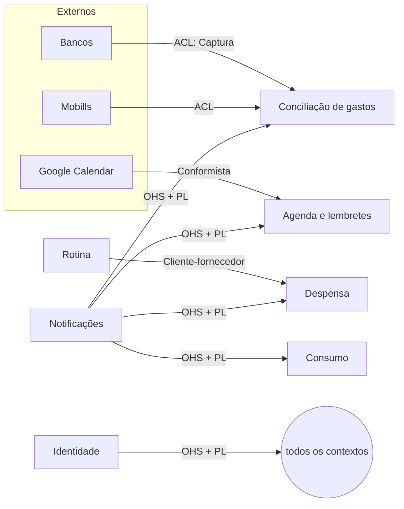

# Ninho: mapa estratégico de DDD

24/11/2026

## Resumo

O domínio do Ninho é a gestão do dia a dia da família. Ele se divide em 9 subdomínios (2 core), desenhados como 7 bounded contexts que se integram com 3 sistemas externos (os bancos, o Mobills e o Google Calendar).

Os dois cores são a conciliação de gastos e a detecção de falhas de consumo. É neles que vale o melhor esforço de modelagem e de teste. Todo o resto é supporting ou generic.

## Subdomínios

O tipo vem só de dois critérios: a complexidade da regra de negócio (não a técnica) e o diferencial, ou seja, se dá para usar algo pronto.

| Subdomínio | Tipo | Por quê |
| --- | --- | --- |
| Conciliação de gastos | core | Razão de o app existir. Casar anotação com lançamento (RF-G-09) e lembrar o que cada estabelecimento costuma ser (RF-G-10). Ninguém vende isso. |
| Detecção de falhas de consumo | core | Escore z modificado, banda do hidrômetro e CUSUM (RF-C-06). É a regra mais sofisticada do app e nenhum produto faz isso para o seu hidrômetro. |
| Captura de notificações dos bancos | supporting | Não existe pronto, mas a regra é traduzir texto. Não diferencia nada. |
| Registro de leituras | supporting | Cadastro de leitura e conta, com validação simples. |
| Rotina (tarefas, pontos, listas) | supporting | Regra trivial. Na rigor seria generic, porque existe app pronto; é construído porque o Ninho é case de estudo (registrar em ADR). |
| Agenda e lembretes | supporting | O que é seu é pouco: categorias, cor por pessoa e o lembrete que repete até alguém marcar "feito" (RF-A-05). |
| Despensa | supporting, pode evoluir | No MVP é "tem" ou "acabou". Vira core se o cardápio da semana que respeita o perfil alimentar ganhar regra própria. |
| Notificações (push, e-mail) | generic | Problema que todo app tem, com soluções prontas (Firebase, OneSignal, SendGrid). |
| Identidade, família e papéis | generic | Login, membros e papéis são iguais em qualquer app. |
| Calendário e classificação financeira | generic, comprados | Resolvidos pelo Google Calendar e pelo Mobills. Não são código do Ninho. |

## Bounded contexts

Um bounded context é a fronteira dentro da qual cada termo tem um só significado. Subdomínio se descobre (espaço do problema); bounded context se desenha (espaço da solução). Por isso não são 1 para 1: Consumo junta dois subdomínios num contexto só, porque os dois falam a mesma língua.

| Contexto | Subdomínios | Linguagem que marca a fronteira |
| --- | --- | --- |
| Conciliação de gastos | Conciliação (core) + Captura como ACL | anotação, lançamento, conciliada, quem gastou, meio de pagamento |
| Consumo | Detecção (core) + Registro de leituras | leitura, ciclo, hidrômetro, conta, atenção, alerta |
| Rotina | Rotina | tarefa, responsável, pontos, lista, item da lista (quem pediu, comprado) |
| Despensa | Despensa | item da casa (tem, acabou, categoria), perfil alimentar |
| Agenda e lembretes | Agenda | evento, recorrência, categoria, lembrete, "feito" |
| Notificações | Notificações | mensagem, canal, destinatário, tentativa, entregue |
| Identidade | Identidade, família e papéis | família, membro, papel, sessão |

Três palavras testaram as fronteiras:

- **Item.** O item da lista some depois de comprado e pode ser um remédio que nunca esteve na Despensa. O item da casa continua existindo. São dois conceitos com o mesmo nome, então Rotina e Despensa ficam separados.
- **Lembrete.** A Agenda decide o que lembrar, quando e até quando insistir (RF-A-05). Notificações só entrega uma mensagem num canal. Se a regra de repetir fosse para Notificações, ela deixaria de ser genérica.
- **Pessoa.** É o mesmo ator do mundo real com um modelo diferente em cada contexto: membro com papel na Identidade, responsável com pontos na Rotina, quem gastou na Conciliação. Os contextos se ligam só pelo id.

## Mapa de contextos

A regra que decide cada relação externa: ACL onde protege o core, conformista onde o modelo do outro lado é bom o bastante e o contexto é supporting.

Identidade e Notificações ficam embaixo porque não conhecem ninguém e servem todos. A Rotina é upstream da Despensa porque não precisa saber que ela existe.

| Upstream | Downstream | Padrão | Por quê |
| --- | --- | --- | --- |
| Bancos | Conciliação de gastos | ACL (a Captura) | Dois formatos que mudam sem aviso, alimentando o core. A Captura traduz o push em "compra capturada"; o RF-G-08 é a ACL dizendo que não conseguiu traduzir. |
| Mobills | Conciliação de gastos | ACL | Alimenta o core (RF-G-09). Se o Mobills for trocado, só a ACL muda. |
| Google Calendar | Agenda e lembretes | Conformista | Contexto supporting e modelo de evento que é quase um padrão da indústria. Vira ACL se a Agenda ganhar regra que o Google não representa. |
| Rotina | Despensa | Cliente-fornecedor, Despensa conformista | A Despensa chama "adicionar à lista" e escuta "item comprado", ignorando o que não é dela. |
| Notificações | Agenda, Consumo, Conciliação, Despensa | OHS + Published Language | Um contrato estável (destinatário, canal, texto, quando) para quatro consumidores. |
| Identidade | Todos | OHS + Published Language | Publica membro e papel; os outros guardam só o id. |

Nenhum Shared Kernel: cada contexto modela "pessoa" e "item" do seu jeito.

**Serviço extraído:** Notificações (decidido em 26/11). É o contexto com mais consumidores e o contrato mais estável, não tem regra de negócio do Ninho e concentra o que justifica um processo separado (fila com atraso, retry, DLQ, entrega idempotente, RNF-P-02). A Agenda continua como módulo do monólito.

## DDD tático

Só os dois contextos core ganham Domain Model; o resto fica com padrões mais simples, e nenhum usa Event Sourcing. Decidido nas sessões de 25 e 26/11.

### Padrão de lógica de negócio por contexto

| Contexto | Padrão | Por quê |
| --- | --- | --- |
| Conciliação de gastos | Domain Model | Regra complexa no core. Sem Event Sourcing: o Ninho não é o livro-razão do dinheiro, quem é são o banco e o Mobills. |
| Consumo | Domain Model | Regra de detecção complexa no core. O escore z é função pura sobre a série e pode morar fora das entidades. |
| Rotina | Active Record | Regra simples, supporting. |
| Despensa | Active Record | Regra simples, supporting. Nunca é agregado de algo da Rotina: agregado não cruza bounded context. |
| Agenda e lembretes | Active Record | Supporting. A sincronia com o Google é integração, não muda o padrão. |
| Notificações | Transaction Script | Fluxo procedural: receber, enviar, tentar de novo. |
| Identidade | Active Record, se não for comprado | Generic: primeiro avaliar solução pronta, como o Supabase Auth. |

No Active Record a regra fica fora do objeto, num serviço que mexe nos campos. No Domain Model a regra mora dentro do objeto, que recusa estados inválidos e não sabe que existe banco.

### Entidades e objetos de valor na Conciliação

O teste é a igualdade: importa *qual* é (entidade, igual por id) ou só os valores (objeto de valor, igual por atributos e imutável).

| Conceito | Tipo | Identidade ou motivo |
| --- | --- | --- |
| Anotação | Entidade | Muda de estado e continua sendo a mesma. |
| Lançamento (Mobills) | Entidade | Dois cafés iguais no mesmo dia são duas linhas diferentes. Id vem do Mobills (a confirmar se o CSV traz um id estável). |
| Compra capturada | Entidade (e um fato, ver eventos) | Chave da notificação no Android (RNT-08): a mesma notificação duas vezes não duplica. |
| Memória do estabelecimento (RF-G-10) | Entidade | Acumula histórico; o nome normalizado é a identidade. |
| Estabelecimento na compra | Objeto de valor | No MVP é só o texto do push. |
| Dinheiro | Objeto de valor | Centavos em inteiro, moeda BRL, validação no construtor. Evita a obsessão por primitivos. |
| Meio de pagamento | Objeto de valor | "Cartão de crédito, bandeira X" é definido pelos atributos. |
| Quem gastou | Objeto de valor (MembroId) | A pessoa é entidade na Identidade; aqui só a referência por id. |
| Data e hora | Objeto de valor | Definida só pelo valor. |

### Agregados e invariantes

Uma transação altera um agregado só. Quando uma regra envolve dois, ela mora no que precisa poder dizer não, e o outro fica sabendo por evento.

| Agregado (raiz) | Invariante que protege | Estado mínimo |
| --- | --- | --- |
| Lançamento | Um lançamento casa com uma anotação só. `conciliarCom(anotacaoId)` recusa o segundo e publica "Lançamento conciliado". | Id da anotação casada |
| Anotação | Conciliada não volta a pendente sem ação explícita (RF-G-03). Escuta "Lançamento conciliado" e faz `marcarConciliada`. | Estado e id do lançamento |
| Hidrômetro | Leitura nova não é menor que a anterior, salvo a virada de 999 para 000 (RF-C-01), mesmo entre ciclos. | Só a última leitura |

A Leitura é objeto de valor, e o histórico de leituras fica fora do agregado, de onde a detecção do RF-C-06 lê a série. Em aberto: se a anotação já estiver conciliada com outro lançamento, o lançamento precisa desfazer o casamento (compensação, o padrão Saga).

### Eventos e comandos entre contextos

Comando é intenção, no imperativo, para um destinatário que pode recusar. Evento é fato, no passado, para quem quiser ouvir.

| Mensagem | Tipo | Observação |
| --- | --- | --- |
| Despensa → Rotina: adicionar item à lista | Comando | Leva o id do item da Despensa como id de correlação. |
| Rotina → Despensa: item comprado | Evento público, ECST | Leva o estado e devolve o id de correlação; a Despensa ignora item sem ele. Versionado: só adiciona campos, mudança quebrando vira v2. |
| Captura → Conciliação: compra capturada | Evento | Sai da ACL e cria uma anotação pendente. |
| Consumo → Notificações: enviar alerta | Comando | Usa a Published Language de Notificações. |
| Lançamento conciliado | Evento interno | Só dentro da Conciliação; muda de formato quando quiser. |

### Consumo

Três agregados e um serviço de domínio, fechados em 26/11. O mesmo Ciclo serve água e energia; a energia só não tem hidrômetro nem leitura semanal.

| Bloco | Tipo | Guarda | Invariante ou papel |
| --- | --- | --- | --- |
| Hidrômetro | Agregado (raiz) | Só a última leitura | Leitura nova não é menor que a anterior, salvo a virada de 999 para 000, mesmo entre ciclos (RF-C-01). |
| Leitura | Objeto de valor | m³ e data | Foto de um número num momento; não muda. |
| Ciclo | Agregado (raiz) | Medidor (água ou energia), HidrometroId quando for água, período, leitura ou kWh da conta, Dinheiro da conta, estado (aberto, fechado) | Começa onde o anterior terminou, sem buraco nem sobreposição. Ciclo fechado pela conta não muda mais. |
| Alerta | Entidade (agregado próprio) | CicloId, nível (atenção com M ≥ 2, alerta com M ≥ 3), estado (disparado, confirmado, descartado) | Tem ciclo de vida: nasce disparado e recebe a resposta "era mesmo um problema?" (RF-C-07). |
| Detecção de falhas | Serviço de domínio | Nada: é lógica sem estado | Na leitura semanal, aplica a banda de ±1 m³. No fechamento do ciclo, aplica escore z modificado e CUSUM sobre os últimos 12 ciclos sem alerta confirmado (RF-C-06). |

Por que o Ciclo não fica dentro do Hidrômetro: o Hidrômetro carregaria todos os ciclos para sempre, e a leitura de domingo e a chegada da conta são ações diferentes que não precisam travar uma à outra. Pertencer não é proteger.

Mensagens do Consumo:

| Mensagem | Tipo | Quem recebe | Alcance |
| --- | --- | --- | --- |
| Leitura registrada | Evento | Detecção (banda semanal) e histórico de leituras | Interno |
| Ciclo fechado | Evento | Detecção (escore z e CUSUM) e modelo de leitura do consumo agregado (RNT-13) | Interno |
| Alerta disparado | Evento | Quem envia o aviso para Notificações | Interno |
| Enviar alerta de consumo | Comando | Notificações (RF-C-07) | Público |
| Alerta descartado | Evento | Base da detecção, que devolve o ciclo aos "12 sem alerta", e a métrica de alarme falso | Interno |
| Alerta confirmado | Evento | Base da detecção, que mantém o ciclo fora da base | Interno |

### Contextos supporting e generic

Rascunho escrito a partir do PRD, sem rodada de perguntas. Como são Active Record ou Transaction Script, o agregado aqui marca só a fronteira de consistência e de concorrência; a regra fica nos serviços. Pontos marcados "a confirmar" são decisões que o PRD não fecha.

| Contexto | Agregado (raiz) | Dentro dele | Invariante ou regra |
| --- | --- | --- | --- |
| Rotina | Tarefa | Recorrência (VO), Pontos (VO), Responsável (MembroId), Conclusão (entidade: quem, quando, foto) | Pontos não negativos. Conclusão vale sem aprovação (RF-R-02). Cada ocorrência de tarefa recorrente se conclui uma vez. |
| Rotina | Lista de compras | Nome (mercado, farmácia, feira) | A lista só agrupa; os itens ficam fora dela (próxima linha). |
| Rotina | Item da lista | Descrição, quem pediu (MembroId), comprado, ListaId, referência de origem (id de correlação da Despensa), versão | Agregado próprio, e não dentro da Lista, para duas pessoas mexerem em itens diferentes sem conflito. A versão por item atende o RF-R-05 (nada se perde sem aviso). |
| Rotina | Placar e Mural | Não são agregados | Modelos de leitura (CQRS, RNT-13) alimentados por "Tarefa concluída". |
| Despensa | Item da casa | Nome, Categoria (VO), Estado (tem, acabou), lista de destino na Rotina | Marcar "acabou" duas vezes não pede o item duas vezes. Só "item comprado" com a referência dele volta o estado para "tem". |
| Despensa | Perfil alimentar | Preferências, restrições, não gosta (VOs), por MembroId | Dado de saúde, só dentro da família (RNF-P-08). |
| Agenda | Evento | Período (VO), Recorrência (VO), Categoria (VO), participantes (MembroId), configuração de lembretes (antecedência), id no Google | Em conflito com o Google vale a última edição, com aviso (RF-A-02). |
| Agenda | Lembrete | EventoId, horário, exige confirmação, estado (pendente, enviado, feito), tentativas | Repete até alguém marcar "feito" (RF-A-05); depois de feito, para. Separado do Evento porque o agendador mexe nele enquanto pessoas editam o evento. |
| Notificações | Envio | Destinatário (MembroId), canal, conteúdo, chave de idempotência, tentativas, estado | Mesma chave não envia duas vezes (RNT-08). Falha esgotada vai para a DLQ (RNF-P-05). |
| Notificações | Preferências de canal | Por MembroId: push e e-mail ligados ou desligados | Cada pessoa liga e desliga cada canal (RF-A-04). Fica aqui, e não na Agenda, porque vale para as mensagens de todos os contextos. |
| Identidade | Família | Membros (entidade: nome, papel), Papel (VO: administrador, responsável, dependente) | Papel aplicado no backend de cada contexto (RNF-P-09). A família sempre tem pelo menos um administrador. |

Serviços de domínio previstos fora do Consumo: a sugestão de casamento entre anotação e lançamento (RF-G-09) e a memória por estabelecimento (RF-G-10), os dois na Conciliação. Repositórios: um por agregado, como porta da arquitetura hexagonal (RNT-02).

### Catálogo de eventos e comandos

As mensagens públicas são contrato e se versionam; as internas mudam livremente. As do Consumo estão na seção acima.

| Origem | Mensagem | Tipo | Quem recebe | Alcance |
| --- | --- | --- | --- | --- |
| Captura (ACL) | Compra capturada | Evento | Conciliação, que cria a anotação pendente (RF-G-06) | Interno ao contexto |
| Captura (ACL) | Notificação não lida | Evento | Tela de pendências do administrador, com o texto original (RF-G-08) | Interno ao contexto |
| Conciliação | Enviar "o que foi isso?" | Comando | Notificações, para quem comprou (RF-G-07) | Público |
| Conciliação | Lançamento conciliado | Evento | Anotação | Interno |
| Consumo | ver "Mensagens do Consumo", acima | | | |
| Rotina | Tarefa concluída | Evento | Placar e Mural (modelos de leitura) | Interno |
| Rotina | Item da lista alterado | Evento | Quem está com a lista aberta, por WebSocket (RNT-09) | Interno |
| Rotina | Item comprado | Evento, ECST | Despensa | Público, versionado |
| Despensa | Adicionar item à lista | Comando | Rotina, com o id de correlação (RF-D-02) | Público |
| Despensa | Enviar "item acabou" | Comando | Notificações (RF-A-06) | Público |
| Agenda | Enviar lembrete | Comando | Notificações (RF-A-04) | Público |
| Agenda | Lembrete confirmado | Evento | O próprio Lembrete, que para de repetir (RF-A-05) | Interno |
| Agenda | Evento alterado | Evento | ACL do Google Calendar, para a sincronia (RF-A-02) | Interno |
| Notificações | Envio falhou | Evento | DLQ e administrador (RNF-P-05) | Público, opcional |
| Identidade | Membro adicionado, Papel alterado | Evento, ECST | Todos os contextos, que guardam uma cópia local de membro e papel | Público, versionado |

Decidido em 26/11: não há lembrete semanal da leitura de água, então o Consumo não envia nenhuma mensagem de lembrete.

## Referências

| Tema | Livro Full Cycle | Mind map de DDD |
| --- | --- | --- |
| Subdomínios e tipos | p. 138–140 | Ramo verde "Domínio e subdomínios" e ramo salmão "Aplicando na prática › 2. Identifique os subdomínios" |
| Evolução do tipo de subdomínio | não cobre | Ramo verde-água "Evoluções", canto superior direito |
| Espaço do problema vs solução | p. 140–141 | Ramo verde |
| Bounded contexts e linguagem ubíqua | p. 142–148 | Ramo lilás "Contexto delimitado" (Módulos, Dicas de tamanho) e ramo verde-água "Linguagem Ubíqua" |
| Mapa de contextos e padrões | p. 149–155 | Ramo lilás "Integração entre contextos" |

O Learning Domain-Driven Design (Vlad Khononov) cobre os mesmos temas nos capítulos 1 a 4. Os critérios de complexidade e diferencial usados aqui são dele.

Para desenhar o mapa: [ddd-crew/context-mapping](https://github.com/ddd-crew/context-mapping), indicado no livro na p. 155.
